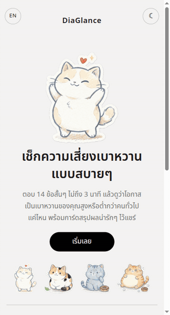
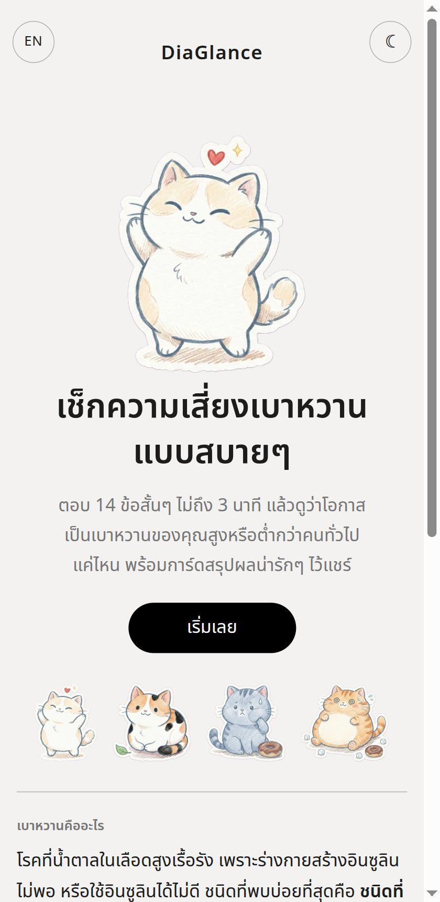
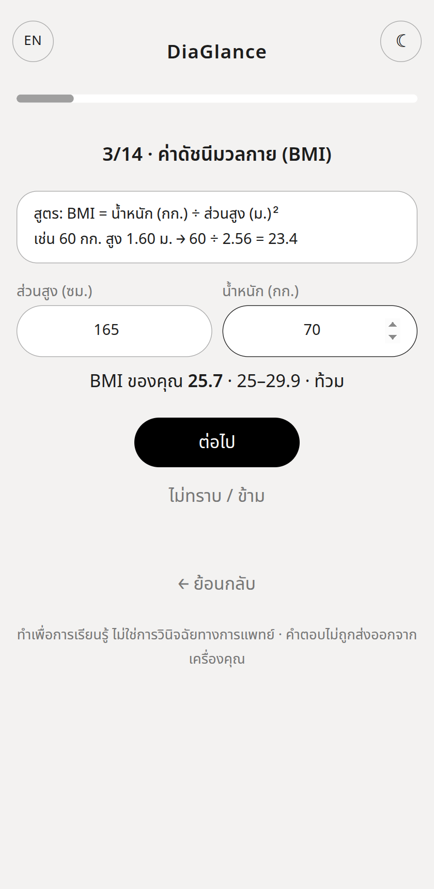
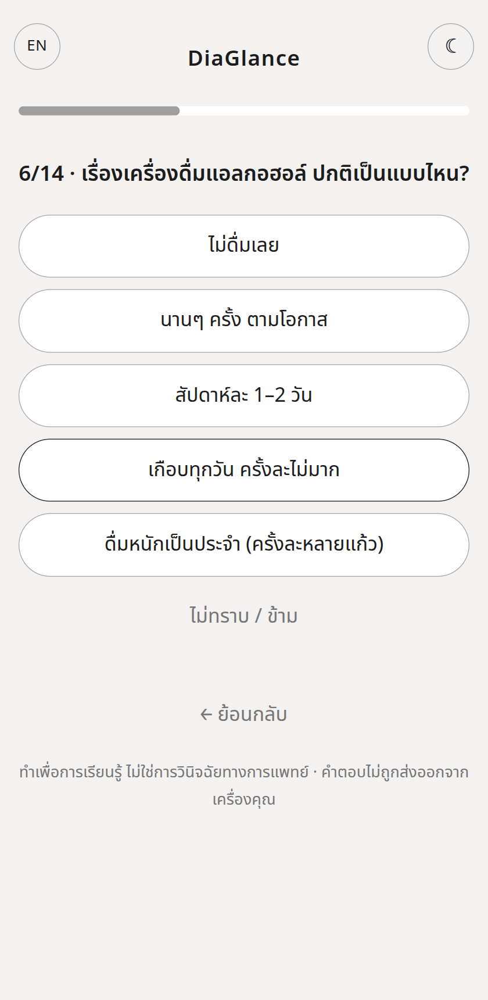
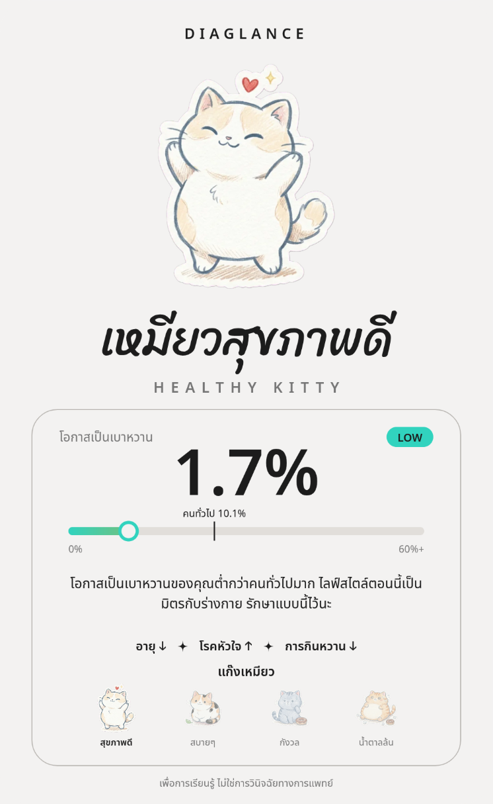
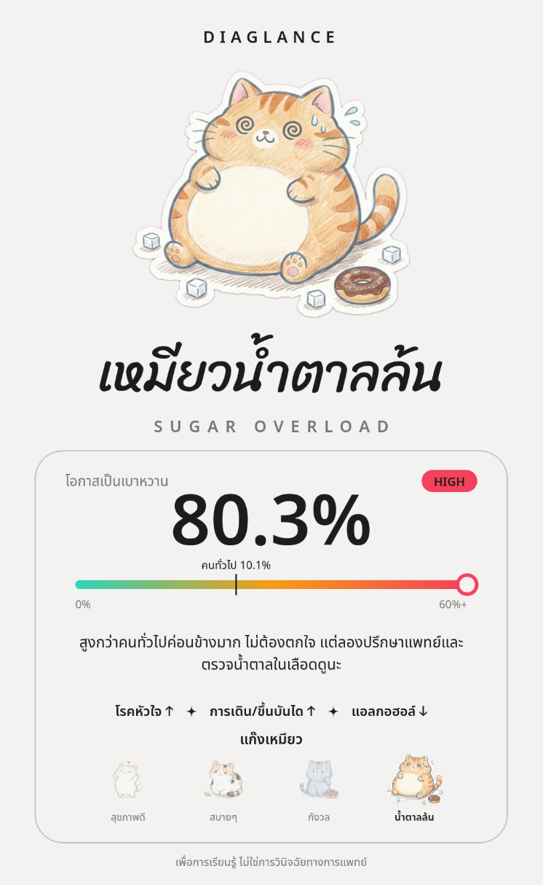
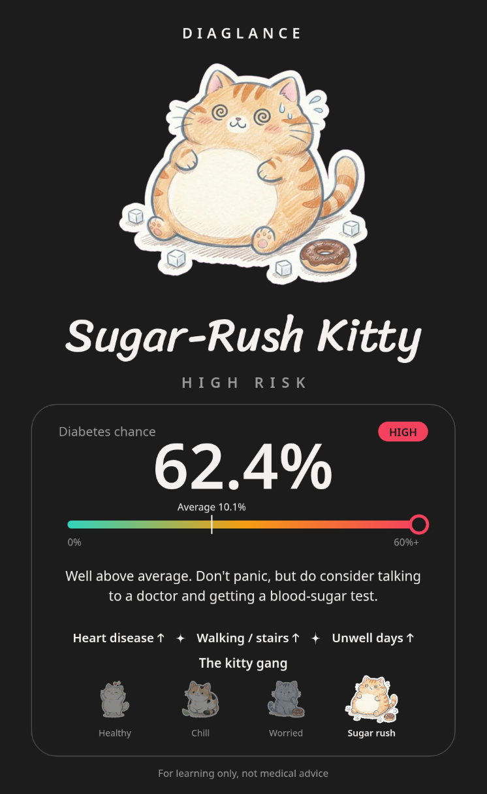

# 🐱 DiaGlance

**เช็กความเสี่ยงเบาหวานแบบสบายๆ** ตอบ 14 ข้อสั้นๆ ไม่ถึง 3 นาที แล้วดูว่าโอกาสเป็นเบาหวานของคุณสูงหรือต่ำกว่าคนทั่วไปแค่ไหน พร้อมการ์ดสรุปผลลายเส้นแมวไว้บันทึกและแชร์

> *A relaxed, 14-question diabetes-risk quiz (Thai / English). It combines risk factors from ~750,000 survey respondents with Naive Bayes and ends with a shareable cat result card. Static site, no backend, your answers never leave your device. For learning only — not medical advice.*

**ลองเล่น:** https://moshika-may.github.io/DiaGlance/

<p align="center"></p>

> ⚠️ ทำเพื่อการเรียนรู้ ไม่ใช่การวินิจฉัยทางการแพทย์ ถ้ากังวลควรตรวจน้ำตาลในเลือดกับแพทย์

---

## ภาพหน้าจอ

| หน้าแรก | คำนวณ BMI | คำถามแบบ 5 ระดับ |
|:---:|:---:|:---:|
|  |  |  |

**การ์ดผลลัพธ์** มี 4 ตัวละครตามระดับความเสี่ยง บันทึกเป็นรูปหรือแชร์ได้ (ขนาด 1080×1758)

| ความเสี่ยงต่ำมาก | ความเสี่ยงสูง | อังกฤษ + โหมดมืด |
|:---:|:---:|:---:|
|  |  |  |

---

## ฟีเจอร์

- **14 ข้อ ใช้เวลาไม่ถึง 3 นาที** ทำได้ทั้งมือถือและคอม มีตัวเลือก "ไม่ทราบ / ข้าม" ทุกข้อ
- **คำถามเข้าใจง่าย** ใช้ระดับ 5 ขั้น เช่น การนอน การออกกำลังกาย การกินหวาน (สั่งเครื่องดื่มหวานแค่ไหน) แทนคำถามใช่/ไม่ใช่ตรงๆ และรวมโรคประจำตัวเป็นข้อติ๊กเดียว
- **ตัวช่วยคำนวณ BMI** กรอกส่วนสูงกับน้ำหนัก พร้อมแสดงสูตรและระดับให้ทันที
- **ผลลัพธ์ที่อธิบายได้** บอกว่าแต่ละคำตอบดันความเสี่ยงขึ้นหรือลงกี่เท่า มีตารางละเอียดทุกข้อ
- **การ์ดแชร์ได้** ตัวละครแมว 4 ระดับ เกจ/แถบสเกลเทียบกับค่าเฉลี่ยคนทั่วไป ปุ่ม **บันทึกรูป / แชร์** (มือถือเปิดหน้าต่างแชร์ คอมดาวน์โหลด PNG) และ **คัดลอกสรุป** เป็นข้อความ
- **ภาษาไทย / English** สลับได้ทุกหน้า ไม่เสียคำตอบ
- **โหมดสว่าง / มืด** ตามระบบ สลับเองได้ การ์ดผลลัพธ์เปลี่ยนตามธีม
- **รีเฟรชแล้วไม่หาย** จำคำตอบและหน้าปัจจุบันไว้ในเบราว์เซอร์ (localStorage)
- **ไม่มีหลังบ้าน** คำตอบไม่ถูกส่งออกจากเครื่อง ไม่มีบัญชี ไม่มีการวิเคราะห์ผู้ใช้ (มีแค่การโหลดฟอนต์จาก Google Fonts)

---

## วิธีใช้งาน

### สำหรับผู้ใช้ทั่วไป
1. เปิด https://moshika-may.github.io/DiaGlance/
2. กด **เริ่มเลย** แล้วตอบทีละข้อ (กด "ย้อนกลับ" หรือ "ข้าม" ได้)
3. ดูผลลัพธ์ ตัวเลข % แถบเทียบกับคนทั่วไป และปัจจัยที่มีผลมากที่สุด
4. กด **บันทึกรูป / แชร์** เพื่อส่งการ์ดให้เพื่อน หรือ **คัดลอกสรุป** เพื่อวางในแชท
5. ปุ่มมุมซ้ายบน (`EN` / `ไทย`) เปลี่ยนภาษา ปุ่มมุมขวาบน (☾ / ☀) เปลี่ยนธีม

### สำหรับนักพัฒนา

ไม่ต้องติดตั้งอะไร เป็นไฟล์ static ล้วน:

```bash
git clone git@github.com:Moshika-May/DiaGlance.git
cd DiaGlance
python3 -m http.server 8000      # แล้วเปิด http://localhost:8000
```

> เปิด `index.html` ตรงๆ ด้วย `file://` ก็ใช้ทำแบบสอบถามได้ แต่เบราว์เซอร์จะบล็อกการบันทึกรูปที่มีภาพแมว (การ์ดจะสลับไปใช้ตัวสำรองแทน) ควรเปิดผ่านเซิร์ฟเวอร์

**สร้างตารางความน่าจะเป็นใหม่** (`model.js`) จากชุดข้อมูล ใช้แค่ Python stdlib:

```bash
# วางไฟล์ไว้ใน data/ (โฟลเดอร์นี้อยู่ใน .gitignore ไม่ถูกอัปโหลด)
#   data/heart_2020_cleaned.csv
#   data/heart_2022_with_nans.csv
python3 -I tools/build.py
```

**ปรับแต่ง**

| อยากทำอะไร | แก้ที่ไหน |
|---|---|
| เปลี่ยนค่าตั้งต้น P(D) | ค่าคงที่ `PRIOR` ใน `index.html` (ตอนนี้ 0.101 ตามไฟล์สรุปโครงงาน) |
| เพิ่ม/แก้คำถามหรือตัวเลือก | `Q` และ `EXTRA` ใน `tools/build.py` แล้วรัน `python3 -I tools/build.py` (ต้องเติมคำอังกฤษใน `EN` ด้วย ตัวสร้างจะ error ถ้าจำนวนไม่ตรง) |
| เปลี่ยนข้อความ/ชื่อตัวละคร | `PERSONA` และ `STR` ใน `index.html` |
| เปลี่ยนสี/ธีม | ตัวแปร CSS ที่ต้น `<style>` (`:root` และ `[data-theme=dark]`) |
| เปลี่ยนรูปแมว | ดูหัวข้อถัดไป |

**เปลี่ยนรูปแมว** ให้เจนภาพทีละตัวบนพื้นสีม่วงแดงเรียบ (`#FF00FF`) แล้ว:

```bash
pip install pillow                                      # ใช้ในสคริปต์ตัดพื้นหลังเท่านั้น
python3 -I tools/cutout.py ต้นฉบับ.png assets/cat1_white.png   # ตัดพื้นหลังให้โปร่งใส (เพิ่ม --preview เพื่อดูบนพื้นสว่าง/มืด)
magick assets/cat1_white.png -resize 640x640 -quality 82 img/cat1.webp
```

`tools/cutout.py` รองรับภาพตาราง 2×2 ด้วย: `python3 -I tools/cutout.py ภาพ.png assets --grid`

**นำขึ้น GitHub Pages:** push ขึ้น `main` แล้วไปที่ Settings → Pages → Source: *Deploy from a branch* → Branch `main` / `/ (root)` ไฟล์ที่ต้องมีคือ `index.html`, `model.js`, `img/`

---

## คำนวณยังไง

ใช้ **Naive Bayes** ตามสรุปสูตรของโครงงาน: ปัจจัยแต่ละข้อถูกสมมติให้เป็นอิสระต่อกันเมื่อรู้สถานะเบาหวาน แล้วปรับโอกาสขึ้น/ลงทีละข้อ

```
P(D | x₁…xₙ) =        P(D) · ∏ P(xᵢ | D)
               ───────────────────────────────────────────
               P(D) · ∏ P(xᵢ | D)  +  P(¬D) · ∏ P(xᵢ | ¬D)
```

- **P(D)** ค่าตั้งต้น = 10.1% (ความชุกเบาหวานของคนไทยจากไฟล์สรุปโครงงาน อ้างอิง NHES)
- **P(xᵢ | D)** และ **P(xᵢ | ¬D)** นับจากข้อมูลสำรวจ BRFSS ปี 2020 + 2022 รวมกัน (ใช้ Laplace smoothing)
- ตัวส่วนคือ Evidence แบบ normalize ผลจึงไม่เกิน 100% (สูตรในไฟล์สรุปที่หารด้วย P(S)·P(G) ตรงๆ จะเกิน 100% ได้เมื่อมีหลายปัจจัย)
- ตัวเลข "×เท่าตัว" ในตารางผลลัพธ์ = P(x|D) ÷ P(x|¬D) ตัวอย่างจากข้อมูล: โรคไต ≈ ×4.3, โรคหัวใจ ≈ ×3.2, เดินลำบาก ≈ ×2.9

**ข้อมูลที่ใช้:** 757,445 คน (หลังตัดแถวที่ไม่มีคำตอบเบาหวานและเบาหวานขณะตั้งครรภ์) เป็นเบาหวาน 101,960 คน (13.5% ในข้อมูลชุดนี้)

### ข้อจำกัด (อ่านก่อนเอาไปอ้างอิง)

- **ข้อมูลเป็นของสหรัฐฯ ไม่ใช่ไทย** แต่ใช้ค่าตั้งต้นของไทย (10.1%) ผสมกัน ตัวเลขจึงเป็นภาพรวมเพื่อการเรียนรู้เท่านั้น
- **ปัจจัย "การกินหวาน" เป็นค่าสมมติ** ข้อมูล BRFSS ที่ใช้ไม่มีตัวแปรนี้ จึงใช้ตัวเลขตัวอย่างจากไฟล์สรุป (กลุ่มกินหวานจัด 0.60 เทียบ ~0.38) และเฉลี่ย 3 ข้อคำถามเป็นปัจจัยเดียว หน้าผลลัพธ์ระบุ "(ค่าสมมติ)" ไว้
- **ข้อสูบบุหรี่ / แอลกอฮอล์ / ออกกำลังกาย / การเดิน** ผู้ใช้เลือกได้หลายระดับ แต่ข้อมูลเก็บแค่ ใช่-ไม่ใช่ จึงรวมเป็น 2 กลุ่มก่อนคำนวณ (เช่น "ดื่มหนักเป็นประจำ" เท่านั้นที่นับเป็น "ใช่")
- **ตัวแปรของสองชุดข้อมูลไม่ตรงกันทั้งหมด** (เช่น แอลกอฮอล์ปี 2022 ถามว่าดื่มหรือไม่ ไม่ใช่ดื่มหนัก) จึงใช้เฉพาะชุดปี 2020 สำหรับข้อนั้น
- **ข้อแอลกอฮอล์ให้ผล "ลดความเสี่ยง" ซึ่งไม่ใช่เหตุและผล** ในข้อมูล คนที่เป็นเบาหวานดื่มหนักน้อยกว่า (3.0% เทียบ 7.4% และเป็นแบบเดิมในทุกช่วงอายุ) น่าจะเพราะคนที่เป็นแล้วมักลดการดื่มลง ไม่ได้แปลว่าการดื่มหนักช่วยป้องกัน หน้าผลลัพธ์แสดงหมายเหตุกำกับ และการ์ด/ข้อความที่ใช้แชร์จะไม่นำข้อนี้ไปแสดงฝั่ง "ช่วยลดความเสี่ยง"
- **สมมติฐานอิสระต่อกันไม่จริงเสมอ** (เช่น BMI กับการออกกำลังกายสัมพันธ์กัน) ผลที่ได้อาจสุดโต่งเมื่อตอบกลุ่มเสี่ยงหลายข้อพร้อมกัน
- ไม่นับประวัติครอบครัว ผลเลือด หรือยาที่ใช้ และไม่ได้ผ่านการตรวจสอบทางคลินิก

---

## โครงสร้างโปรเจกต์

```
index.html     หน้าเว็บทั้งหมด (HTML + CSS + JS ไฟล์เดียว): คำถาม, การคำนวณ, การ์ดผลลัพธ์, แปลภาษา
model.js       ตารางความน่าจะเป็นที่สร้างจาก tools/build.py (ไฟล์สร้างอัตโนมัติ อย่าแก้ด้วยมือ)
tools/
  build.py     อ่านไฟล์ใน data/ แล้วสร้าง model.js; เก็บคำถาม/ตัวเลือกภาษาไทยและอังกฤษ
  cutout.py    ตัดพื้นหลังสีม่วงแดงของรูปแมวให้โปร่งใส
img/           รูปแมว 4 ตัวสำหรับเว็บ (WebP)
docs/          ภาพหน้าจอและ GIF สำหรับ README
data/          ชุดข้อมูล CSV (ไม่ถูกอัปโหลด อยู่ใน .gitignore)
assets/        ไฟล์ต้นฉบับรูปแมวขนาดเต็ม (ไม่ถูกอัปโหลด อยู่ใน .gitignore)
```

ไม่มีชุดทดสอบอัตโนมัติ ตรวจด้วยการกดทดสอบหน้าเว็บ และ `tools/build.py` มี assertion ตรวจว่าข้อความภาษาอังกฤษครบทุกตัวเลือก

---

## เครดิตและที่มา

- **ข้อมูล:** BRFSS (Behavioral Risk Factor Surveillance System) ของ CDC ปี 2020 และ 2022 ในรูปไฟล์ `heart_2020_cleaned.csv` / `heart_2022_with_nans.csv` ควรตรวจเงื่อนไขการใช้งานของแหล่งที่คุณดาวน์โหลดก่อนเผยแพร่ซ้ำ
- **สูตรและค่าตั้งต้น:** *สรุปสูตรความน่าจะเป็นสำหรับการรวมชุดข้อมูล* (โครงงานวิชาวิทยาการข้อมูลและความน่าจะเป็น)
- **ภาพแมว:** สร้างด้วยโมเดลสร้างภาพ AI (Gemini) แล้วตัดพื้นหลังด้วย `tools/cutout.py`
- **ฟอนต์:** [Noto Sans Thai](https://fonts.google.com/noto/specimen/Noto+Sans+Thai) และ [Sriracha](https://fonts.google.com/specimen/Sriracha) ผ่าน Google Fonts (SIL OFL)

## ลิขสิทธิ์

โค้ดอยู่ภายใต้ [MIT License](LICENSE)
